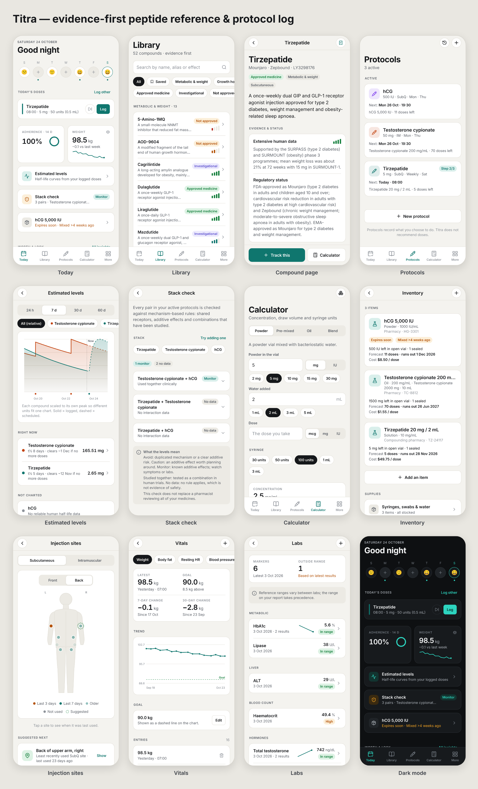

# peppedia-copy → Titra

Research on PepPedia, and **Titra**: our own evidence-first peptide reference and private protocol tracker, built from that research.



| Path | What it is |
|---|---|
| [`mobile/`](mobile/) | The Titra app (Expo SDK 58, React Native, TypeScript). iOS, Android and web. |
| [`server/`](server/) | Optional "Ask Titra" server that answers questions with Claude, grounded in the app's library. |
| [`docs/titra-architecture.md`](docs/titra-architecture.md) | How Titra works, feature by feature, and how it answers PepPedia's weaknesses. |
| [`docs/peppedia-analysis.md`](docs/peppedia-analysis.md) | The PepPedia teardown: product, mechanics, architecture, business, risks. |

## Quick start

```bash
cd mobile && npm install && npx expo start   # i / a / w for iOS, Android, web
npm test                                     # domain engine + store tests
```

Titra is an educational and record-keeping tool. It is not medical advice and does not recommend doses.
